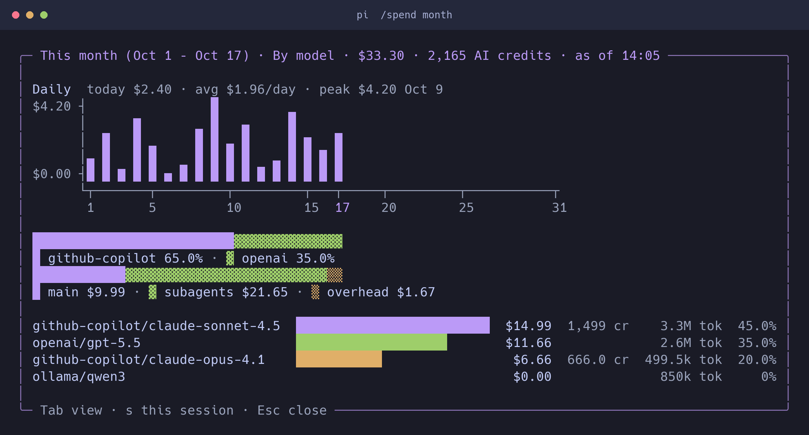

# pi-dev-team

pi-dev-team gives the [pi coding agent](https://pi.dev) a team of AI agents. The team writes a spec, makes a plan, builds the code with tests, reviews it and opens a pull request. You approve each important step. pi-dev-team works with every provider that pi supports, for example GitHub Copilot, Anthropic and OpenAI.

## Quick start

Install pi and the package:

1. Install pi: `npm install -g @earendil-works/pi-coding-agent`
2. Install pi-dev-team: `pi install git:github.com/sanjit-roopra/pi-dev-team`
3. Start pi in a Git repository: `cd my-project && pi`
4. Log in to a provider: `/login`

To install for one project only, use `pi install -l git:github.com/sanjit-roopra/pi-dev-team` in step 2.

Give the team its first task:

1. Check the install: `/dev-team doctor`
2. Install each required tool that the report marks `MISSING` (see [Requirements](#requirements)). `semgrep` is optional.
3. Prepare the repository: `/setup`
4. Give the team a task: `/specs add rate limiting to the public API`

Result: the team asks about the open points, writes a spec and starts `/plan` by itself. After you approve the plan, run `/build`. When `/build` reports done, run `/pr`.

## Requirements

| Tool | Version | If it is missing |
|---|---|---|
| [Node.js](https://nodejs.org) | 22.19+ | pi does not start. |
| [pi](https://pi.dev) | 1.0+ | The package does not load. |
| Git | recent | Most commands do not work. |
| Python | 3.10+ | The guard hooks (scripts that run around a tool call) are off, and pi shows a warning. The [example check](#the-quality-bar-and-the-example-check) cannot run. |
| [GitHub CLI](https://cli.github.com) (`gh`) | recent | `/pr` and `/ship` cannot open a pull request. |
| `jq` | any | Some quality gates do not run. |
| [`lizard`](https://github.com/terryyin/lizard) | any | The quality bar installs it into the project's environment. |

## Give the team a task

Run `/ship <task>` to run all four steps for you, with the same questions. Or run each command yourself, in this order.

### The four commands

The team works in four steps:

| Command | What it does | Result |
|---|---|---|
| `/specs <task>` | Asks questions until the task is clear. Then it writes the spec: intent, architecture notes and acceptance criteria. | A spec file or a GitHub issue |
| `/plan` | Splits the work into slices, and each slice into small steps with their tests. | `plans/<task>.md` |
| `/build` | Builds one slice at a time: tests, code, review. | Commits on your branch |
| `/pr` | Runs the tests, the linter and a code review, then opens a pull request. | A pull request |

Each approval is a question with a time limit. See [Answer, wait or skip questions](#answer-wait-or-skip-questions).

This is the default flow, with the gate review profile. For more review, see [Get more review](#get-more-review).

### A plain request gets a brief first

When you type a request without a command, the team first shows a brief (a short summary of the planned work). The model picks one of these kinds:

| Kind | When | What happens |
|---|---|---|
| question | No file changes | The team answers. There is no brief. |
| tiny | One sentence, at most 3 files | The brief shows 3 lines, and the team goes on. |
| feature | A bigger change | The brief shows "At a glance" (at most 15 lines) and asks for your ok. |
| vague | Decisions that only you can make | The team runs `/specs`, which asks those decisions in rounds. |
| resume | The message answers a running command | The command goes on. |

For a feature brief, you choose:

| You choose | What happens |
|---|---|
| "Go: build it (recommended)" | The team runs `/ship`. |
| "Change something" | You type what to change. The team posts a new brief. |
| "Stop" | No files change. The team asks what you want instead. |
| No answer in time | The team runs `/ship`. `/pr` lists the assumptions of the brief under "Decide these". |

A tiny change can grow past 3 files or 150 lines. Then pi-dev-team tells the team one time to post a new brief or to stop and run `/ship`. To turn off the brief, set `"routing": "off"` (see [Configuration](#configuration)).

### Answer, wait or skip questions

Each question waits 120 seconds (`askTimeoutSec`), then the team takes the recommended answer and goes on. Each question shows its time left.

| To do this | Do this |
|---|---|
| Stop the timer for the rest of this set of questions | In a pick-an-option dialog in pi's TUI, press `w`. |
| Skip a question | Press `Esc`. The team takes the recommended answer and asks no more questions of that set. |
| Make every question in this session wait for you | Run `/dev-team wait`. |
| Switch back to timeouts | Run `/dev-team timeout`. |
| Make one request wait for every answer | Write "grill me" or "ask me everything" in the request. |
| Wait always, in every session | Set `"answerMode": "wait"` in `~/.pi/agent/dev-team.json`. |

The team can also send a [phone message](#get-a-phone-message-when-the-team-goes-on-alone).

### /specs and approved examples

`/specs` asks the open decisions in rounds, each with a recommended answer. Then it writes the intent, the architecture notes and the acceptance criteria to a file under `docs/specs/` or to a GitHub issue. When you wrote the spec together with the team, `/specs` starts `/plan`. For a document that you bring, it offers `/plan` as the next step.

pi-dev-team saves your request word for word in `.pi/dev-team/memory/requests/`. The plan and the reviewers check the work against that file, not against a model summary. With the example check on, it saves each plain request that you type while the team is idle. It also saves the text after `/specs`, `/plan` and `/ship`. With the check off, it saves only the command text. An issue number, a URL or a file path alone (`/ship 123`, `/specs docs/spec.md`) is not saved. Then the issue or the document is the request. Do not commit the folder (see [Keep state out of Git](#keep-state-out-of-git)).

With the example check on, `/specs` also proposes examples for each acceptance criterion that your request shows no example for. Read each example before you approve it. The tests compare the exact outputs: formats, precision, suffixes and error text.

| You choose | What happens |
|---|---|
| Approve | pi-dev-team saves the text that you saw, unchanged. The check then accepts these examples. |
| Edit them first | An editor opens. pi-dev-team saves your edited text instead. |
| Reject | Nothing is saved. The agent asks what is wrong, or proposes other examples. |
| No answer in time, `Esc`, an empty editor, or no human | Nothing is saved. The spec lists the examples under "Decide these". |

Details: [Approved examples in /specs](docs/review-profiles.md#approved-examples-in-specs) and [Which requests are saved](docs/review-profiles.md#which-requests-are-saved).

### /plan and /build

`/plan` writes a short plan to `plans/<task>.md`. A slice is one part of the feature, from input to output, with its own steps and tests. Each step has one line for its code, one for its test and one for its refactor. You approve the plan. Then run `/build`, or let `/ship` run it.

`/build` starts one implementer agent per slice, and each slice gets one commit. A review runs at each slice and fixes only `error` findings, in one round. The build report lists the `warning` and `suggestion` findings.

The gate rules for each step are in [docs/review-profiles.md](docs/review-profiles.md#what-gate-changes).

### /pr and auto-merge

To prevent auto-merge, use one of these commands:

- `/pr --no-auto-merge`
- `/pr --draft`
- `/ship --no-auto-merge`

`/pr` runs the tests, the linter and a code review. Then it opens the pull request and turns on auto-merge (`gh pr merge --auto --squash`). The pull request merges by itself when the checks and the required reviews pass. If the repository does not allow auto-merge, the pull request stays open.

When `gh` is logged in and the run skipped steps or left problems, `/pr` files one issue. The pull request links it under "Residual risks". If `gh` fails, `/pr` reports it and goes on.

If the team took answers for you, the pull request lists them under "Decide these".

After `/setup`, the project `/pr` in `.pi/skills/pr/SKILL.md` replaces the package `/pr` in a trusted project. `/setup` writes that file for your project, so its steps can differ. This section describes the package `/pr`.

### The quality bar and the example check

The quality bar applies to all code: plain requests, `/fix`, review fixes and `/build`. Each function has at most 60 lines, at most 5 parameters and a cyclomatic complexity of at most 10. Cyclomatic complexity is the number of paths through the code. The agent runs the linter and `lizard` before it reports code work done. See [The quality bar](docs/review-profiles.md#the-quality-bar).

The example check makes the input-to-output examples of your request into acceptance tests in `.dev-team/examples.json`. It is on by default.

- Give concrete examples in your request, in fenced code blocks. Examples written only in prose do not become cases.
- Each fenced block that you paste needs a case, or a skip with a reason.
- To turn the check off, start pi with `DEV_TEAM_EXAMPLES=off pi`.

In 52 SlopCodeBench checkpoints, the check passed 78.2% of hidden tests against 70.3% without it, at about 10% more cost. See [Example check](docs/review-profiles.md#example-check).

## Other commands

| Command | What it does |
|---|---|
| `/code-review` | About 20 review agents check your change, one topic each, for example security, tests and naming. |
| `/triage <bug>` | Finds the root cause and writes a fix plan. |
| `/fix <bug>` | Triages the bug, proves it with a test, fixes it and opens a pull request. |
| `/continue` | Continues the work of your last session. |
| `/spend` | Shows what your sessions cost. See [See where the spend went](#see-where-the-spend-went). |
| `/telemetry on` | Logs the cost of each run for `/cost-report`. It also logs which commands you use, on your machine only. |
| `/dev-team` | Shows the package status: `pi-dev-team <version>`, configuration files, tiers, agents and hooks. |
| `/dev-team models`, `hooks`, `doctor` | Map tiers to models, list the guard hooks, or check the install. |
| `/dev-team wait`, `timeout` | Questions wait for you, or time out (this session). |
| `/help`, `/help --all` | The main commands, or all commands. Neither lists `/spend` or `/dev-team`. |

## Choose the models

To map tiers to models, run `/dev-team models` and pick a preset. A tier is a model class that an agent names, for example `sonnet`. By default, every tier uses your session model.

| Tier | Used for |
|---|---|
| `opus` | Deep reviews and hard design |
| `sonnet` | Most work |
| `haiku` | Small checks |
| `fable` | The strongest tier. No package agent uses it by default. |

The presets are `github-copilot`, `anthropic`, `inherit` (your session model, the default) and `custom` (you set each tier).

A code review can start about 20 agents, so cheaper lower tiers save money. `/dev-team doctor` suggests a preset for the provider of your session.

## Get more review

To run more review, start pi with another review profile (the review steps of `/plan`, `/build`, `/code-review` and `/ship`):

```bash
DEV_TEAM_REVIEW=lean pi   # more review lenses and plan critics
DEV_TEAM_REVIEW=full pi   # every review step the commands describe
DEV_TEAM_FARLEY=on pi     # also a test-quality score at the end of /build
```

| Profile | What it runs |
|---|---|
| `gate` | The default: the quality bar, the example check and a short review at each slice. |
| `lean` | Plan critics and four review lenses at each slice. No quality bar in every session and no example check. |
| `full` | Every step that the commands describe, with the Farley Score (a test-quality score of 8 properties). |

Set `DEV_TEAM_REVIEW`, `DEV_TEAM_FARLEY` and `DEV_TEAM_EXAMPLES` in your shell, not in the `env` of a configuration file. A project file cannot set them, so a cloned repository cannot lower your review. See [Choose a profile](docs/review-profiles.md#choose-a-profile).

## Get a phone message when the team goes on alone

If you do not answer a question in time, the team can tell your phone. It uses ntfy, a free phone app. You need no account.

1. Install the ntfy app from the App Store or Google Play.
2. Make up a long random name, for example `dev-team-k3v9q2x7m4`.
3. In the app, tap `+` and subscribe to that name.
4. Add the name to `~/.pi/agent/dev-team.json`: `{ "notify": "ntfy:dev-team-k3v9q2x7m4" }`

Result: the message shows what the team builds, or the answers that it took for you.

Anyone who knows the name can read your messages. The name is 1 to 64 letters, digits, `-` or `_`. For your own ntfy server, use `ntfy:<https url>`. The URL must start with `https://` and end with the topic. For any other value, pi sends nothing and shows a warning. A message holds at most 3500 characters.

## Safety and cost

To limit the work, set these in `~/.pi/agent/dev-team.json`:

```json
{ "maxParallelAgents": 2, "subagentTimeoutSec": 900 }
```

The agents can do what you can do in a terminal. They change files, run commands and make many model calls, with up to 6 agents at once.

- The guard hooks block some actions, for example `gh pr create` before a code review passes.
- The destructive-command guard (a guard hook for risky commands) marks some commands `CAUTION`. When you are at the terminal, pi asks before it runs one. No answer in time means no. Without a human, or with `askTimeoutSec: 0` and no wait mode, pi only shows the warning.
- The same guard blocks `git push --force` and `git branch -D` against the default branch, and `git reset --hard` on the default branch. While `/careful` mode is on, it blocks every risky command.
- pi shows each running agent: its time, its cost, its current command and its place in the queue.
- The footer of pi shows the session cost in USD, agents included. With GitHub Copilot, the status line also shows the AI credits of the session.

### See where the spend went

Run `/spend` for a chart of what your sessions cost, for every provider. Local models count as $0.



| To do this | Do this |
|---|---|
| Switch the view: By model, By provider, By agent | Press `Tab`. |
| Switch the scope: this session, or this month in all projects | Press `s`, or run `/spend session` or `/spend month`. |
| Close the chart | Press `Esc` or `q`. |

In the thread bar, main is `█`, agents are `▓` and overhead is `▒`. Without a terminal UI, `/spend` prints text. The month starts on the 1st at 00:00 UTC.

| Term | Meaning |
|---|---|
| USD | The catalog price of pi for the tokens. With a subscription plan, for example a ChatGPT plan, this is not what the plan bills. |
| AI credits | The unit of GitHub Copilot: 1 credit per $0.01 of the Copilot USD price, before the allowance of your plan ([pricing](https://docs.github.com/en/copilot/reference/copilot-billing/models-and-pricing)). |

`/spend` also works without the team. To use it alone, switch off `extensions/dev-team/index.ts` with `pi config` (or `pi config --local`).

## Configuration

Later files override earlier ones:

1. `~/.pi/agent/dev-team.json`: yours, for all projects.
2. `<project>/.pi/dev-team.json`: the project's, in Git.
3. `<project>/.pi/dev-team.local.json`: yours, for one project, not in Git.

pi-dev-team reads both project files only when pi trusts the project. The local file has the same limits as the project file. "User file only" means `~/.pi/agent/dev-team.json` only. `PI_CODING_AGENT_DIR` replaces the folder `~/.pi/agent`. The process environment comes last: `DEV_TEAM_MAX_PARALLEL_AGENTS` overrides `maxParallelAgents`.

### Agents and models

| Key | Default | What it does |
|---|---|---|
| `models` | every tier `"inherit"` | Tier to `provider/model-id`, or `inherit` for the session model |
| `thinking` | `low`, `medium`, `high`, `xhigh`, `max` to the same name | Agent effort to pi thinking level |
| `maxParallelAgents` | `6` | The most agents at once. A project file can set 1 to 16. |
| `maxSubagentDepth` | `2` | How deep agents can start agents |
| `subagentTimeoutSec` | `3600` | Stop an agent after this many seconds. `0` means no limit. |
| `allowPiSubagents` | `false` | `true` lets the model use the tools of pi-subagents. User file only. |

### Questions, text and routing

| Key | Default | What it does |
|---|---|---|
| `askTimeoutSec` | `120` | Questions wait this long, then the team goes on. `0` means never ask. User file only. |
| `answerMode` | `"timeout"` | `timeout`, or `wait`: questions wait for you. User file only. |
| `routing` | `"brief"` | `brief` or `off`: a brief before a plain request changes files |
| `notify` | `""` | `"ntfy:<name>"`: the [phone message](#get-a-phone-message-when-the-team-goes-on-alone). User file only. |
| `githubStyle` | `"block"` | `block`, `warn` or `off`: the text check below |

<a id="pull-request-and-issue-text"></a>
The team keeps pull request, issue and comment text short and plain. Before `gh pr` or `gh issue` `create`, `edit` or `comment` sends text, pi-dev-team checks it. The same rules check the questions (`ask_user`) and the briefs of the team. With `block`, a rule break is blocked one time, and the agent gets the fix. With `warn`, the agent gets only a note. With `off`, both checks and the style guide in the system prompt are off. The rules are in [GitHub text style check](docs/architecture.md#github-text-style-check).

### Context and tools

| Key | Default | What it does |
|---|---|---|
| `autocompactMaxTokens` | `200000` | Compact the session between runs at this many context tokens. `0` means off. A project file can set `0`, or 50000 and more. |
| `autocompactPct` | not set | Compact the session between runs at this percent (1 to 100) of the context window of the model. `/setup` offers `40`. |
| `skillIndex` | `"compact"` | `compact`, `full` or `off`: the command list in the system prompt |
| `skillIndexChars` | `220` | The longest description in that list |
| `readDedup` | `true` | Reading an unchanged file again gives a short note. |
| `autoFormat` | `false` | Format files after each edit. `/setup` sets it. |
| `cliShim` | `true` | Put `bin/dev-team-run` on `PATH`, so scripts that call it run an agent through pi |

For `autocompactPct`, the first source that sets it wins: `DEV_TEAM_AUTOCOMPACT_PCT` in the process environment, then `.pi/dev-team.local.json`, `.pi/dev-team.json` and `~/.pi/agent/dev-team.json`.

### Hooks and environment

| Key | Default | What it does |
|---|---|---|
| `hooks` | `{ "enabled": true, "disabled": [...], "enable": [], "outputToModel": true, "timeoutSec": 60 }` | The guard hooks. `disabled` lists the hooks that are off. `enable` turns one of them on. User file only. |
| `env` | `{}` | Environment variables for tools, hooks, scripts and agents, for example `"DEV_TEAM_MAX_PARALLEL_BUILDS": "2"` |

Setting `disabled` replaces the default list. To turn off one more hook, copy the defaults and add it. The defaults are `cost_meter`, `subagent_skill_context`, `code_intelligence_nudge`, `code_intelligence_turn_mark`, `phase_marker` and `version_check`. `/dev-team hooks` shows which hooks are on.

A project file cannot change `hooks`, so a cloned repository cannot turn off your guards. The `env` of a project file can set only the tuning variables in `PROJECT_ENV_SETTINGS` (`extensions/dev-team/lib/config.ts`). Each value must be plain: at most 64 letters, digits, `.`, `_` or `-`. `/dev-team` lists each project key that it ignored.

### Allow a file that looks like a secret

<a id="sensitive-file-guard"></a>
To allow a file that looks like a secret, add a pattern to the `env` of `~/.pi/agent/dev-team.json`:

```json
{ "env": { "DEV_TEAM_GUARD_ALLOWED_PATHS": "test/fixtures/*,*.example" } }
```

Agents cannot write `~/.pi/agent/dev-team.json`, so only you can add an exception. A project file cannot set this variable.

The sensitive-file guard blocks the write and edit tools on files such as `.env`, `*.key` or `*.pem`. It does not check bash commands. The full list is in `hooks/guards.json`. `*.md` files are exempt. A pattern without `/` matches the file name only. Approval in chat does not lift the block. See [Sensitive-file guard](docs/architecture.md#sensitive-file-guard).

## Files pi-dev-team keeps in your project

| Path | What it holds | In Git |
|---|---|---|
| `.pi/dev-team/memory/`, `metrics/`, `plans/` | Saved requests, the brief, build and review state, cost rows and review verdicts | No, after `/setup` |
| `.pi/dev-team/` (other) | `worktrees/`, `review-summaries/`, `evals/`, `hooks/` and state files | No, if you ignore `.pi/dev-team/` (see [Keep state out of Git](#keep-state-out-of-git)) |
| `.pi/agents/` | Project agents. They take precedence over the package agents. | Yes, to share them |
| `.pi/skills/pr/SKILL.md` | The project `/pr` that `/setup` writes. In a trusted project, it replaces the package `/pr`. | Yes |
| `.pi/dev-team.json` | Project configuration | Yes |
| `.pi/dev-team.local.json` | Your configuration for this project | No |
| `plans/<task>.md` | The plan that `/plan` writes | No, after `/setup` |
| `docs/specs/` | The spec files that `/specs` writes | Yes |
| `.dev-team-reports/` | Reports of review and analysis commands | No, except `test-improve/` |
| `.dev-team/examples.json` | Cases of the [example check](#the-quality-bar-and-the-example-check) | See [Keep state out of Git](#keep-state-out-of-git) |
| `AGENTS.md` | Project instructions that `/setup` writes. If the repository has a `CLAUDE.md` and no `AGENTS.md`, `/setup` adds to that file. | Yes |

Your own files are in `~/.pi/agent/`: `dev-team.json`, `dev-team/telemetry.json` and `dev-team/metrics/`. For internals, see [State on disk](docs/architecture.md#state-on-disk).

### Keep state out of Git

Do not commit `.pi/dev-team/memory/`. It holds every request that you typed.

`/setup` adds these lines to `.gitignore`:

```gitignore
.pi/dev-team/memory/
.pi/dev-team/metrics/
.pi/dev-team/plans/
.pi/dev-team.local.json
/.dev-team-reports/*
!/.dev-team-reports/test-improve/
memory/
reports/
metrics/
plans/
.pr-review-passed
.mcp.json
```

The bare `plans/` line keeps `plans/<task>.md` out of Git. `.mcp.json` holds machine-specific MCP configuration.

Add `.pi/dev-team/` yourself to cover the rest, for example `worktrees/`. Do not ignore all of `.pi/`, because `.pi/dev-team.json` and `.pi/agents/` belong in Git.

The cases in `.dev-team/examples.json` quote the saved requests. Cases committed without their requests fail the check on a fresh clone. So do one of these:

- Keep `.dev-team/examples.json` out of Git too.
- Commit both. Remove the `.gitignore` that pi-dev-team writes in `.pi/dev-team/memory/requests/`, and un-ignore that folder.

### Move from older .claude folders

Older versions of pi-dev-team kept project state in `.claude/`. At session start, pi-dev-team moves that state to `.pi/dev-team/` and shows what moved. Some things you must do yourself:

1. Move your project agents from `.claude/agents/` to `.pi/agents/`. pi-dev-team no longer reads `.claude/agents/`.
2. Remove the old worktrees in `.claude/worktrees/` with `git worktree remove`.
3. Move each entry that the notice names as on another filesystem.
4. To run the move again, delete `.pi/dev-team/.migrated-from-claude`.

The autocompact percent in the `env` of `.claude/settings.json` no longer applies. Run `/setup` again, or set `autocompactPct` in `.pi/dev-team.json`. An old `claudeShim` key still works as `cliShim`. Other files in `.claude/`, for example `settings*.json` and `CLAUDE.md`, are not pi-dev-team state. pi-dev-team never touches them. The rules are in [One-time migration from .claude](docs/architecture.md#one-time-migration-from-claude).

## Update

```bash
pi update git:github.com/sanjit-roopra/pi-dev-team
```

`/dev-team` shows the installed version.

## Troubleshooting

| Symptom | Cause | Fix |
|---|---|---|
| `dev-team: python >= 3.10 not found — hook guards are disabled.` | pi found no Python 3.10 or later. pi tries `DEV_TEAM_PYTHON`, then `python3`, then `python`. | Install Python 3.10+, or set `DEV_TEAM_PYTHON` to a Python 3.10+ binary. Then restart pi. |
| `/dev-team doctor` shows `dev-team-run` `MISSING` | `cliShim` is `false`. | Set `"cliShim": true`, or ignore it if no script calls `dev-team-run`. |
| `/dev-team doctor` shows `NO AUTH (/login)` | A tier names a model of a provider that you did not log in to. | Run `/login`, or set that tier to `inherit`. |
| `/dev-team doctor` shows `UNKNOWN MODEL` | A tier names a model that is not in the catalog of pi. | Run `/dev-team models` and pick a preset again. |
| `gh pr create` is blocked | No code review passed in the last 1800 seconds (30 minutes), or the branch changed after the review. | Run `/code-review` again, or use `/pr`. To bypass, `export PR_GATE_BYPASS_REASON=<reason>` before you start pi. An inline prefix on the `gh` command does not work. |
| An agent result says `timed out after 3600s` | The agent ran longer than `subagentTimeoutSec`. | Make the task smaller, or raise `subagentTimeoutSec`. |

## More information

- [docs/architecture.md](docs/architecture.md): how the extension, the hooks and the agents work together.
- [docs/review-profiles.md](docs/review-profiles.md): the review profiles and the example check in detail, with all [measured results](docs/review-profiles.md#measured-results).
- [CONTRIBUTING.md](CONTRIBUTING.md): tests and changes to the package.
- [CHANGELOG.md](CHANGELOG.md): the changes in each version.

## License

MIT. See [LICENSE](LICENSE). pi-dev-team is not part of the pi project.
