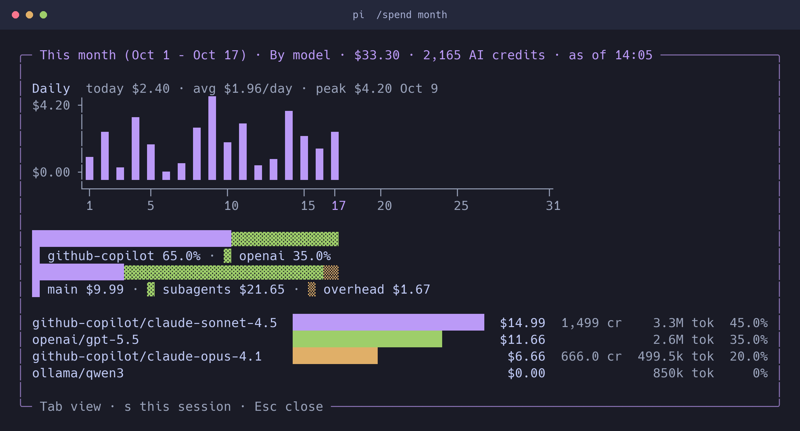

# pi-dev-team

pi-dev-team gives the [pi coding agent](https://pi.dev) a team of AI agents. The team writes a spec, plans, builds with tests, reviews the code, and opens a pull request. You approve each important step.

It is a port of Bryan Finster's dev-team plugin for Claude Code ([bdfinst/agentic-dev-team](https://github.com/bdfinst/agentic-dev-team)). It works with every provider pi supports, for example GitHub Copilot, Anthropic and OpenAI.

## Quick start

1. Install pi: `npm install -g @earendil-works/pi-coding-agent`
2. Install this package: `pi install git:github.com/sanjit-roopra/pi-dev-team`
3. Start pi in a Git repository: `cd my-project && pi`
4. Log in to a provider: `/login`
5. Check the install: `/dev-team doctor`. Install any tool marked `MISSING` (see [Requirements](#requirements)).
6. Prepare the repository: `/setup`
7. Give the team a task: `/specs add rate limiting to the public API`

## Requirements

| Tool | Version | If it is missing |
|---|---|---|
| [Node.js](https://nodejs.org) | 22.19+ | pi does not start. |
| [pi](https://pi.dev) | 1.0+ | The package does not load. |
| Git | recent | Most commands do not work. |
| Python | 3.10+ | The guard hooks are off. pi shows a warning. |
| [GitHub CLI](https://cli.github.com) (`gh`) | recent | `/pr` and `/ship` cannot open a pull request. |
| `jq` | any | Some quality gates do not run. |

A guard hook is a small script that runs around a tool call. It can stop an unsafe action, for example a pull request without a code review.

## How the team works

| Command | What it does | Result |
|---|---|---|
| `/specs <task>` | Asks questions until the task is clear, then writes intent, architecture notes and acceptance criteria. | Spec file or GitHub issue |
| `/plan` | Splits the work into small steps, each with its own tests. | `plans/<task>.md` |
| `/build` | Builds one step at a time: test, make it pass, clean up. | Commits on your branch |
| `/pr` | Runs tests, linter and code review, then opens a pull request. | Pull request |

Each command stops and asks you before it continues. `/ship <task>` runs all four, with the same stops.

A plain request without a command first gets a short brief: what the team builds, when it is done, what it assumes. A bigger task waits for your ok, then runs `/ship`.

Each question shows its time left. Press `w` to make it wait, or run `/dev-team wait` for the session. A request with "grill me" waits too.

### Phone message when the team goes on alone (optional)

If you do not answer in time, the team takes the recommended answer and goes on. It can tell your phone. It uses ntfy, a free phone app. You need no account.

1. Install the ntfy app (App Store or Google Play).
2. Make up a long random name, for example `dev-team-k3v9q2x7m4`. Anyone who knows the name can read your messages.
3. In the app, tap `+` and subscribe to that name.
4. Add the name to `~/.pi/agent/dev-team.json`: `{ "notify": "ntfy:dev-team-k3v9q2x7m4" }`

The message shows what the team builds, or which answers it took for you. Without step 4, nothing is sent.

Other commands:

- `/code-review`: about 25 agents review your change, one topic each (security, tests, naming, ...).
- `/triage <bug>`: finds the root cause and writes a fix plan.
- `/fix <bug>`: triage, prove the bug, fix it with tests, open a pull request.
- `/continue`: continues your last session's work.
- `/help`: the main commands. `/help --all`: all commands.

## Choose the models

Each agent has a tier: `opus` (deep reviews, hard design), `sonnet` (most work), `haiku` (small checks), `fable` (strongest; unused by default).

By default every tier uses your session model. To map tiers to models, run `/dev-team models` and pick a preset:

- `github-copilot`: the Claude models of GitHub Copilot
- `anthropic`: the Claude models of the Anthropic API
- `inherit`: your session model (default)
- `custom`: set each tier yourself

A code review can start 20+ agents, so cheaper lower tiers save a lot. `/dev-team doctor` suggests a preset.

A `/build` step that fails twice retries once on a stronger tier (not with `inherit`), then asks you.

## Safety and cost

The agents can do what you can do in a terminal: change files, run commands, and make many model calls (up to 6 agents at once).

- The guard hooks reduce the risk. For example, they block `gh pr create` until a code review passes. They need Python.
- pi shows each running agent: its time, cost, current command and its place in the queue.
- pi's footer shows the session cost in USD, agents included. With GitHub Copilot, the status line also shows the session's AI credits.

To limit the work, set these in `~/.pi/agent/dev-team.json`:

```json
{ "maxParallelAgents": 2, "subagentTimeoutSec": 900 }
```

### See where the spend went

Run `/spend` for a chart of what your sessions cost, for every provider (local models count as $0).



Example data rendered by `/spend`: monthly trends, provider shares, and main, subagent and overhead costs.

- Views: **By model**, **By provider**, **By agent** (`Tab` to switch).
- Scope: this session, or this month across all projects (`s` to switch). Or run `/spend session` / `/spend month`.
- Bars: main `█`, subagents `▓`, overhead `▒`. Without a terminal UI, `/spend` prints text.
- `Esc` or `q` closes it.

| Term | Meaning |
|---|---|
| USD | pi's catalog price for the tokens. For a ChatGPT or Claude plan, not what the plan bills. |
| AI credits | GitHub Copilot's unit: 1 credit per $0.01 of Copilot's USD, before your plan's allowance ([pricing](https://docs.github.com/en/copilot/reference/copilot-billing/models-and-pricing)). |

The month starts on the 1st at 00:00 UTC.

`/telemetry on` logs each run's cost (`/cost-report`) and, on your machine only, which commands you use.

`/spend` also works without the team: switch off `extensions/dev-team/index.ts` with `pi config` (or `pi config --local`).

## Review profile: gate by default, lean and full on request

> **Changed:** `gate` is now the default review profile. Before, the default was `lean`. To keep the old behavior, start pi with `DEV_TEAM_REVIEW=lean`.

By default the team runs the gate review profile: a code-quality bar in every session, and little review process. To run more review, start pi with another profile:

```bash
DEV_TEAM_REVIEW=lean pi   # the previous default: more review lenses and plan critics
DEV_TEAM_REVIEW=full pi   # every review step of the upstream plugin
```

| Setting | Values | What it does |
|---|---|---|
| `DEV_TEAM_REVIEW` | `gate` (default), `lean`, `full` | How much review `/plan`, `/build`, `/code-review` and `/ship` run |
| `DEV_TEAM_FARLEY` | `off` (default), `on` | Under `gate` and `lean`: run the Farley test score at the end of `/build` |
| `DEV_TEAM_MAX_PARALLEL_AGENTS` | a number, 1 or more | Max agents at once; wins over every config file |

### Gate profile (default)

- A quality bar in every session, not only in `/build`: each function has a cyclomatic complexity of at most 10, at most 60 lines and at most 5 parameters. The agent runs the linter and `lizard -w -C 10 -L 60 -a 5`, and fixes every finding before it reports.
- Where the spec is silent, the agent follows the established standard for the interface: JSON Pointer error locations, RFC 9457 error bodies, RFC 9110 status codes, ISO 8601 times. Where the spec is explicit, the spec wins. **New and experimental:** its first benchmark test showed no effect yet.
- `/plan`: no plan critics.
- `/build`: spec-compliance and correctness review at each slice. The simplify lens and, when selected, security review run at the last slice. No other lens runs.
- Agents write no report files. Every test command runs under `timeout 600`.
- With no human attached, `/build` skips the Feedback & Learning step.

Why gate: on SlopCodeBench, plain pi with only this quality bar matched the lean profile on hidden tests and code shape (no function above complexity 10), at a quarter to half of the time and cost. Plan critics and the larger review panels changed no test result.

### Lean profile (`DEV_TEAM_REVIEW=lean`)

What `lean` changes, compared with `full`:

- `/plan`: at most the standard set of plan critics, one revision round, short plans.
- `/plan`: Gherkin scenarios only for behavior the request states or shows.
- `/build`: one implementer per slice, not one per step; short tasks that point to the plan.
- `/build`: one test per scenario, plus one per request rule no scenario covers.
- `/build`: the implementer runs a step's tests while it works, and lint, type-check, `lizard` and the full suite once at the end. It commits once.
- Reviews: four core lenses per slice; every lens at the last slice. Only `error` findings get fixed, in one round.
- No step 6 backstop review and no Farley score, unless `DEV_TEAM_FARLEY=on`.

Spec-compliance review, structure review, lint, type-check and the complexity check still run at every checkpoint. Their errors are still fixed. Lean has no session-wide quality bar.

Only your shell can set these. A config file's `env` cannot, so a cloned repository cannot change your review profile. An unknown `DEV_TEAM_REVIEW` value means `gate`, with a warning. Details and measured effects: [PORTING.md](PORTING.md).

Most review lenses and plan critics think at `medium` effort (all profiles). A dispatch can lower an agent's effort, but never raise it.

## Pull request and issue text

The team writes for a reader who skims ([SimpleEnglish](https://github.com/AminBlg/SimpleEnglish), [i-have-adhd](https://github.com/ayghri/i-have-adhd)):

- Title: 69 characters or fewer. First sentence: what changes and why.
- Body: 250 words or fewer (comment: 150). Sentences: 25 words. Lists: 5 items.
- No em-dashes, bold, hedges (should, might) or filler (robust, leverage). Long evidence goes in one `<details>` block at the end.

Before a `gh pr` or `gh issue` command writes text, the extension checks it. It blocks a rule break once and tells the agent what to fix; the same command a second time runs. Set `"githubStyle": "warn"` to only warn, or `"off"` to turn it off. Text the shell builds at run time (`--body "$BODY"`) is not checked.

## Configuration

Later files override earlier ones:

1. `~/.pi/agent/dev-team.json`: yours, all projects
2. `<project>/.pi/dev-team.json`: the project's, in Git
3. `<project>/.pi/dev-team.local.json`: yours, one project, not in Git

All settings, with defaults:

```jsonc
{
  "models": { "opus": "inherit", "sonnet": "inherit", "haiku": "inherit", "fable": "inherit" },
  "thinking": { "low": "low", "medium": "medium", "high": "high", "xhigh": "xhigh", "max": "max" }, // agent effort -> pi thinking level
  "maxParallelAgents": 6,      // max agents per process (project file: 1 to 16)
  "maxSubagentDepth": 2,       // how deep agents can start agents
  "subagentTimeoutSec": 3600,  // stop an agent after this
  "autoFormat": false,         // format files after each edit (/setup sets it)
  "githubStyle": "block",      // block, warn or off: PR and issue text rules
  "skillIndex": "compact",     // compact, full or off: command list in the system prompt
  "skillIndexChars": 220,      // max description length in that list
  "autocompactMaxTokens": 200000, // compact between tasks at this many tokens; 0 = off (project: 0 or 50000+)
  "readDedup": true,           // re-reading an unchanged file gives a note
  "claudeShim": true,          // scripts' `claude -p` runs pi
  "allowPiSubagents": false,   // true lets the model use pi-subagents' tools (user file only)
  "askTimeoutSec": 120,        // questions wait this long, then go on; 0 = never ask
  "answerMode": "timeout",     // timeout, or wait: questions wait for you
  "routing": "brief",          // brief or off: a brief before a plain request changes files
  "notify": "",                // "ntfy:<name>": phone message (see above; user file only)
  "env": {},                   // DEV_TEAM_* settings, for example "DEV_TEAM_MAX_PARALLEL_BUILDS": "2"
  "hooks": { "enabled": true, "disabled": ["cost_meter", "..."], "enable": [], "outputToModel": true, "timeoutSec": 60 }
}
```

The process environment comes last: `DEV_TEAM_MAX_PARALLEL_AGENTS` overrides `maxParallelAgents`, and `DEV_TEAM_REVIEW` and `DEV_TEAM_FARLEY` are read only from there (see [Review profile](#review-profile-gate-by-default-lean-and-full-on-request)).

A project file cannot change `hooks`, so a cloned repository cannot turn off your guards. `/dev-team hooks` shows which guards are on.

### Sensitive-file guard

Agents cannot write files that look like secrets, for example `.env`, `*.key` or `*.pem` (full list: `hooks/guards.json`). Approving in chat does not lift the block.

To allow a file, add a pattern in your own `~/.pi/agent/dev-team.json` (a project file cannot):

```json
{ "env": { "DEV_TEAM_GUARD_ALLOWED_PATHS": "test/fixtures/*,*.example" } }
```

## Update

```bash
pi update git:github.com/sanjit-roopra/pi-dev-team
```

For one project only: `pi install -l git:github.com/sanjit-roopra/pi-dev-team`.

## Troubleshooting

| What you see | What to do |
|---|---|
| `dev-team: python >= 3.10 not found — hook guards are disabled.` | Install Python 3.10+, restart pi. |
| `/dev-team doctor` shows `NO AUTH (/login)` | Run `/login`, or set that tier to `inherit`. |
| `/dev-team doctor` shows `UNKNOWN MODEL` | Run `/dev-team models` and pick a preset again. |
| `gh pr create` is blocked | Run `/code-review` first, or use `/pr`. |
| An agent stops after one hour | Make the task smaller, or raise `subagentTimeoutSec`. |

## More information

- [PORTING.md](PORTING.md): how the port works and what differs from the Claude Code plugin
- [CONTRIBUTING.md](CONTRIBUTING.md): tests and upstream updates
- `UPSTREAM.json`: the upstream version (dev-team v14.0.0)

## License

MIT. Upstream content is copyright Bryan Finster (see [LICENSE](LICENSE)). This is an unofficial port, not part of Anthropic or the pi project.
